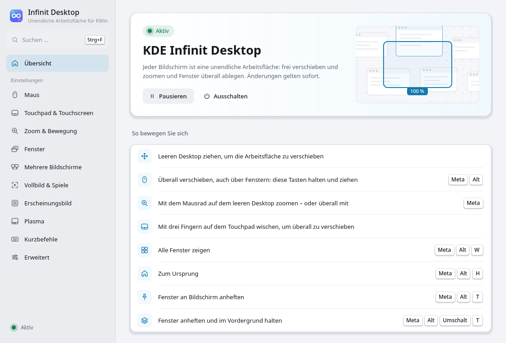

# KDE Infinit Desktop

**Eine unendliche Arbeitsfläche für KDE Plasma 6 – auf jedem Bildschirm.**
*If it runs KDE Plasma, it runs KDE Infinit Desktop.*

KDE Infinit Desktop ist ein KWin-Plugin (Plasma 6.8+, Wayland). Jeder Monitor wird zu einer in alle Richtungen
unendlichen Fläche, auf der Fenster in Originalgröße liegen. Du verschiebst die Fläche mit Maus, Touchpad
oder Tastatur, zoomst mit dem Mausrad heraus, um alles zu überblicken, und wieder hinein, um weiterzuarbeiten.
Taskleiste, Benachrichtigungen und Hintergrundbild bleiben dabei fest stehen.


| Fläche verschieben | Herausgezoomt arbeiten |
|---|---|
|  |  |
| **Fenster außerhalb des Bildes wiederfinden** | **Anpinnen** |
|  |  |

## Funktionen

- **Unendliche Fläche pro Bildschirm** (optional pro virtuellem Desktop) mit eigener Kamera und Lesezeichen.
- **Pannen**: Ziehen auf freier Fläche, Meta+Alt+Ziehen über Fenstern, mittlere Maustaste,
  Zwei-Finger-Scrollen, Drei-Finger-Wischen, Touchscreen; mit **Nachgleiten**.
- **Zoomen**: Mausrad auf freier Fläche, Meta+Mausrad überall, Pinch; rastet bei 100 % ein.
- **Herausgezoomt weiterarbeiten**: Klicken, Scrollen und Tippen gehen direkt an das Programm. Fenster
  lassen sich verschieben (Titelleiste) und in der Größe ändern (Ränder), ohne auf 100 % zu springen.
  Die Programme zeichnen ihren Inhalt für die kleinere Größe neu, Text bleibt lesbar.
- **Nichts geht verloren**: Markierungen am Bildschirmrand zeigen, wo Fenster außerhalb des Bildes liegen,
  ein Klick fliegt hin.
- **Hintergrundbild bleibt statisch**, verträglich mit Wallpaper Engine und waywallen (inklusive deren
  Auto-Pause).
- **Mehrere Bildschirme**:
  - Jeder Monitor hat seine eigene Fläche, Fenster werden am Rand sauber abgeschnitten.
  - Auf den anderen Monitor kommt ein Fenster nur durch **schnelles Ziehen an den Rand**, die
    Geschwindigkeit ist einstellbar.
  - Langsames Ziehen scrollt stattdessen die Fläche.
- **Vollbild**:
  - Videos und Spiele bleiben im Vollbild und lassen sich nicht wegscrollen, solange sie den Fokus haben.
  - Minimiert erscheinen sie als **Kachel** auf der Fläche, wahlweise mit Live-Inhalt oder nur mit
    Programmsymbol (spart Leistung).
- **Anpinnen** von Fenstern an den Bildschirm, optional **immer im Vordergrund**.
- **Fenster öffnen sich dort, wo sie zuletzt waren**: Position, Größe und Bildschirm werden gemerkt.
  Monitore werden über ihre EDID-Daten wiedererkannt.
- **Startmenü** wahlweise an der Taskleiste oder **an der Mausposition**.
- **Taskleiste und Alt+Tab** fahren die Kamera automatisch zum gewählten Fenster.
- **Frei belegbare Tastenkürzel**: Zoom, Übersicht, Home, Fenster in eine Richtung, Lesezeichen,
  Anpinnen. Die Standardbelegung kollidiert nicht mit Plasma.
- **Zwei Einstellungs-Oberflächen**:
  - die eigene **Einstellungs-App** mit Suche, Erklärung zu jeder Option, sofortiger Übernahme und
    Übersicht aller KDE-Tastenkürzel inklusive Doppelbelegungen,
  - die normale Seite in den **Systemeinstellungen**.
- **Verträglich mit anderen Effekten**: Unschärfe bzw. Better Blur, Transparenz, Wobbly Windows, Magic Lamp
  (automatisch getestet).
- **Robust**: Absicherung gegen Absturzschleifen (abgesicherter Modus), in Ruhe keine Leistungskosten,
  Direct Scanout für Spiele bleibt erhalten.



## Installation

Ein Befehl, als normaler Benutzer (nicht mit `sudo`, der Installer fragt selbst nach dem Passwort):

```bash
curl -fsSL https://raw.githubusercontent.com/RandomNam3/kde-infinit-desktop/main/install.sh | bash
```

Oder aus einem Klon des Repositorys:

```bash
git clone https://github.com/RandomNam3/kde-infinit-desktop.git
cd kde-infinit-desktop
./install.sh
```

Der Installer:
- erkennt die Distribution (Debian/Ubuntu/KDE Neon, Arch/CachyOS/Manjaro, Fedora/RHEL, openSUSE,
  Gentoo, …),
- installiert die Build-Abhängigkeiten,
- baut und installiert das Plugin und schaltet es ein,
- richtet einen **automatischen Neubau nach KWin-Updates** ein.

Für jede KWin-Version muss neu gebaut werden, weil KWin Plugins nur mit exakt passender Version lädt.

Alles Weitere, auch fertige Pakete und die Anleitung je Distribution, steht in [docs/INSTALL.md](docs/INSTALL.md).

## Dokumentation

| Dokument | Inhalt |
|---|---|
| [docs/BENUTZERHANDBUCH.md](docs/BENUTZERHANDBUCH.md) | Bedienung, Tastenkürzel, Einstellungen, Fehlerbehebung |
| [docs/INSTALL.md](docs/INSTALL.md) | Installation auf allen Distributionen, Neubau nach Updates |
| [docs/PAKETE.md](docs/PAKETE.md) | Fertige `.deb`/`.rpm`/`.pkg.tar.zst`-Pakete und Build-Dienste |
| [docs/ARCHITEKTUR.md](docs/ARCHITEKTUR.md) | Technische Dokumentation: Aufbau, Datenmodell, Stabilität, Leistung, Tests |

## Selbst bauen

```bash
./build.sh            # konfigurieren, bauen, Unit-Tests
./build.sh --install  # zusätzlich installieren
./build.sh --help     # alle Optionen (Pakete bauen, Container-Builds, Sanitizer, …)
```

Abhängigkeiten: CMake ≥ 3.22, ECM, Qt ≥ 6.8 (Core, Gui, DBus, Widgets, Quick, QuickControls2),
KF6 (Config, CoreAddons, GlobalAccel, I18n, KCMUtils, XmlGui, WidgetsAddons) und die KWin-Entwicklungsdateien
in genau der installierten Version.

Die Bilder und Animationen der Dokumentation entstehen automatisch in einer echten Plasma-Sitzung:
`tools/docs-media/record.ps1` bzw. `record.sh` (siehe [tools/docs-media](tools/docs-media/README.md)).

**Ausprobieren ohne Linux-Rechner:** `tools/demo/start-demo.ps1` (Windows mit Podman) bzw.
`tools/demo/start-demo.sh` startet eine vollständige Plasma-Sitzung mit dem Plugin im Container und öffnet
sie per Remotedesktop.

## Lizenz

GPL-3.0-or-later. KDE und Plasma sind Marken von KDE e.V.; dieses Projekt ist ein unabhängiges
Community-Projekt.
