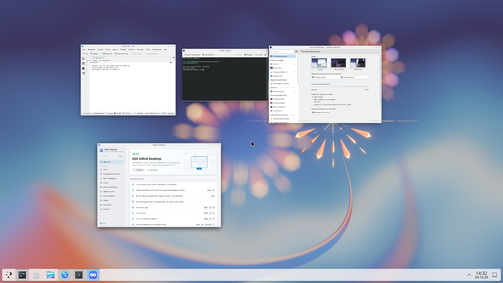
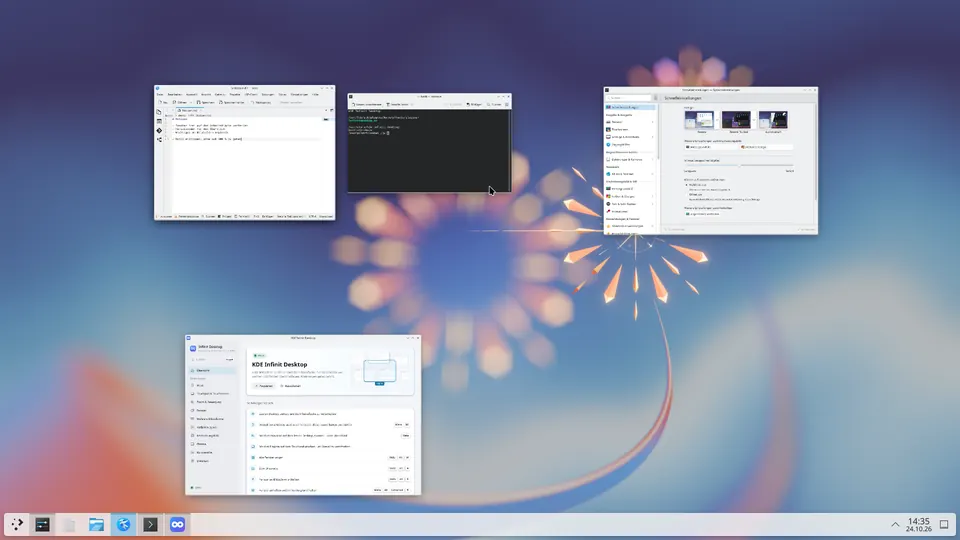
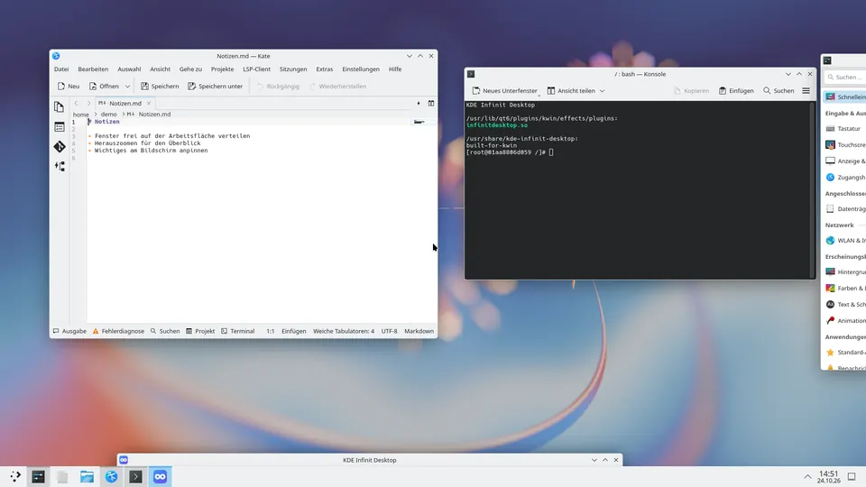
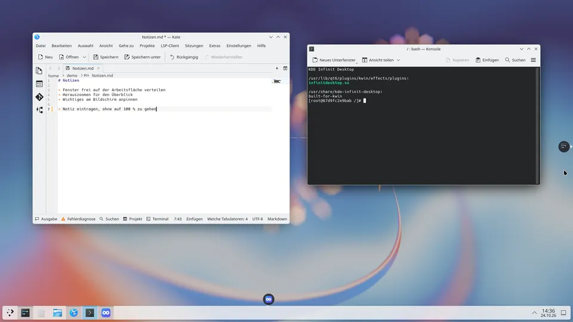
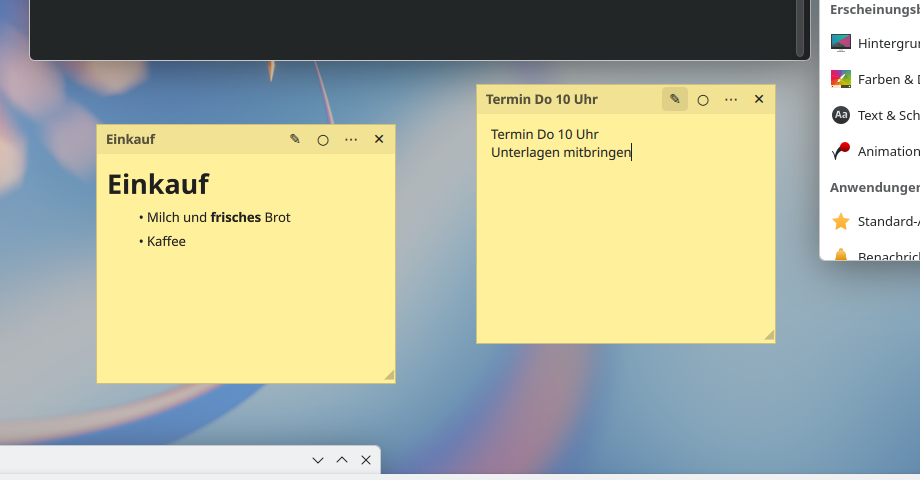
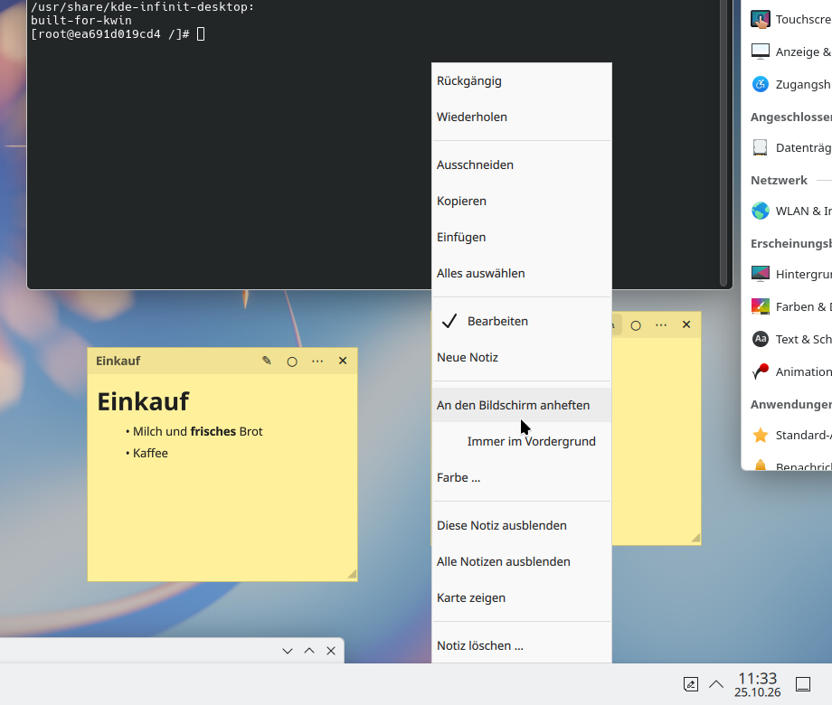
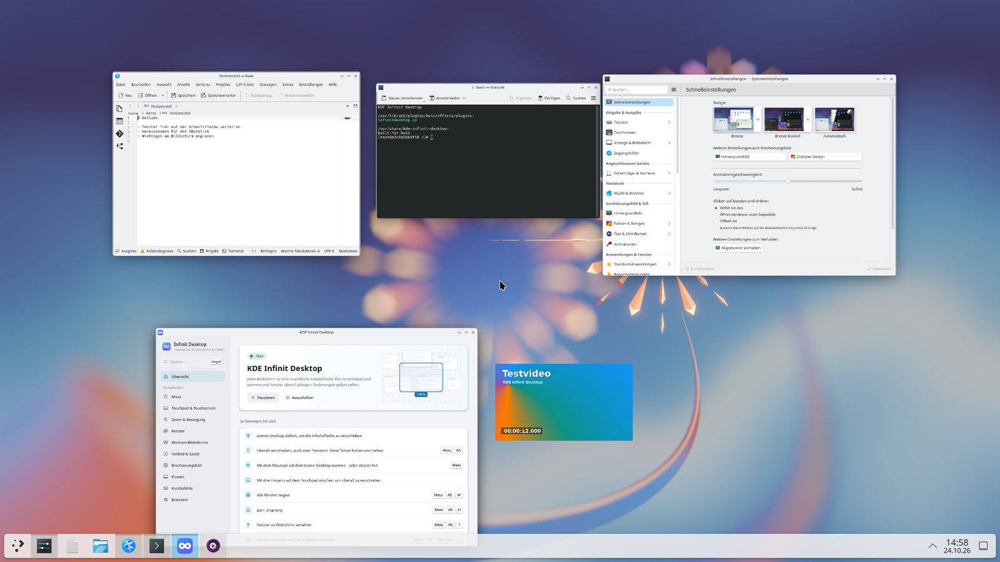

# KDE Infinite Desktop – Benutzerhandbuch

> *If it runs KDE Plasma, it runs KDE Infinite Desktop.*

KDE Infinite Desktop macht jeden Bildschirm zu einer **unendlich großen Arbeitsfläche**. Fenster liegen in
Originalgröße auf dieser Fläche, dein Bildschirm ist wie eine Kamera, die einen Ausschnitt davon zeigt.
Du kannst die Fläche in jede Richtung verschieben, herauszoomen, um alles zu überblicken, und wieder
hineinzoomen – die Taskleiste, Benachrichtigungen und das Hintergrundbild bleiben dabei, wo sie sind.

---

## Inhalt

1. [Voraussetzungen](#voraussetzungen)
2. [Installieren und einschalten](#installieren-und-einschalten)
3. [Die wichtigsten Begriffe](#die-wichtigsten-begriffe)
4. [Bedienung mit Maus](#bedienung-mit-maus)
5. [Bedienung mit Touchpad und Touchscreen](#bedienung-mit-touchpad-und-touchscreen)
6. [Tastenkürzel](#tastenkürzel)
7. [Fenster: finden, anpinnen, immer oben](#fenster-finden-anpinnen-immer-oben)
8. [Fenster öffnen sich dort, wo sie zuletzt waren](#fenster-öffnen-sich-dort-wo-sie-zuletzt-waren)
9. [Notizen, Gruppen, Bereiche und die Karte](#notizen-gruppen-bereiche-und-die-karte)
10. [Mehrere Bildschirme](#mehrere-bildschirme)
11. [Vollbild, Videos und Spiele](#vollbild-videos-und-spiele)
12. [Startmenü an der Mausposition](#startmenü-an-der-mausposition)
13. [Einstellungen](#einstellungen)
14. [Verträglichkeit mit anderen Erweiterungen](#verträglichkeit-mit-anderen-erweiterungen)
15. [Fehlerbehebung](#fehlerbehebung)
16. [Häufige Fragen](#häufige-fragen)

---

## Voraussetzungen

| | |
|---|---|
| Desktop | KDE Plasma **6.8** oder neuer |
| Sitzung | **Wayland** (unter X11 wird das Plugin nicht geladen) |
| Grafik | jede Grafikkarte, mit der Plasma läuft (AMD/Intel mit Mesa, NVIDIA proprietär oder Nouveau/NVK) |
| Distribution | jede mit Plasma ≥ 6.8 – siehe [INSTALL.md](INSTALL.md) |

## Installieren und einschalten

Die ausführliche Anleitung für alle Distributionen steht in [INSTALL.md](INSTALL.md). Kurzfassung:

```bash
./install.sh
```

Das Skript erkennt deine Distribution, installiert die nötigen Pakete, baut das Plugin, installiert es,
schaltet es ein und richtet einen automatischen Neubau nach KWin-Updates ein.

**Ein- und ausschalten:** *Systemeinstellungen → Fensterverwaltung → Arbeitsbereich-Effekte →
„KDE Infinite Desktop“*. Beim Ausschalten werden alle Fenster, die gerade außerhalb des sichtbaren
Bereichs lagen, auf den Bildschirm zurückgeholt – es geht nichts verloren.

## Die wichtigsten Begriffe

**Arbeitsfläche (Canvas)** – die unendliche Fläche. Jeder Bildschirm hat seine **eigene** Fläche, und auf
Wunsch hat jeder virtuelle Desktop pro Bildschirm wieder eine eigene (Einstellung *„Eigene Position für
jeden virtuellen Desktop“*).

**Kamera** – der sichtbare Ausschnitt. Verschieben („pannen“) bewegt die Kamera, zoomen verändert,
wie viel der Fläche du siehst.

**100 % und Übersicht** – bei 100 % arbeitest du ganz normal mit allen Fenstern. Sobald du herauszoomst,
bist du in der *Übersicht*: Alle Fenster werden verkleinert, **live** und scharf angezeigt und bleiben
benutzbar (siehe [Herausgezoomt arbeiten](#herausgezoomt-arbeiten)). Ziehen auf freier Fläche verschiebt
die Ansicht.



**Statisch bleibt:** das Hintergrundbild (auch animierte Hintergründe wie Wallpaper Engine oder waywallen),
die Taskleiste und alle Plasma-Leisten, Benachrichtigungen, Bildschirmanzeigen (Lautstärke, …),
angepinnte Fenster und Vollbild-Fenster.

**Geparkte Fenster** – Fenster, die gerade nicht im Bild sind, legt das Plugin außerhalb aller Bildschirme
ab. Sie verbrauchen dann keine Eingaben und können sich (je nach Anwendung) schlafen legen, was Strom
spart. Ein Fenster, das nur noch zu einem kleinen Teil am Rand hervorschaut, ist eine *Vorschau*: Ein Klick
darauf holt es ganz ins Bild.

## Bedienung mit Maus


| Aktion | Wirkung |
|---|---|
| **Linke Maustaste ziehen auf freier Fläche** | Fläche verschieben (ein kurzer Klick erreicht weiterhin den Desktop) |
| **Mittlere Maustaste ziehen auf freier Fläche** | Fläche verschieben |
| **Meta + Alt + linke Maustaste ziehen** (überall) | Fläche verschieben, auch über Fenstern |
| **Mausrad auf freier Fläche** | Zoomen (zur Mausposition hin) |
| **Meta + Mausrad** (überall) | Zoomen, auch über Fenstern |
| **Umschalt + Mausrad** auf freier Fläche | waagerecht verschieben |
| **Strg + Mausrad** auf freier Fläche | senkrecht verschieben |
| Fenster an den **Bildschirmrand ziehen** | die Fläche scrollt in diese Richtung, das Fenster wandert mit |
| Nach schnellem Ziehen **loslassen** | die Fläche gleitet nach und bremst sanft ab |
| **Klick**, während die Fläche noch gleitet oder fährt | hält sie an (wie beim Smartphone); der nächste Klick geht an das Fenster |

Beim Zurückzoomen rastet der Zoom genau bei 100 % ein – dann sind alle Fenster wieder direkt bedienbar.

Nachgleiten gibt es nur nach einem zügigen, geraden Wisch. Kreist du mit gedrückter Maustaste und lässt
dann los, bleibt die Fläche stehen.

### Herausgezoomt arbeiten

Auch unter 100 % sind die Fenster **voll benutzbar**: Klicks, Scrollen und Tastatureingaben gehen direkt an
das Programm unter dem Mauszeiger, die Zoomstufe bleibt. So trägst du schnell eine Notiz ein, verschiebst
eine Datei oder legst Fenster nebeneinander, ohne zwischen Übersicht und 100 % hin- und herzuspringen.


| Aktion | Wirkung |
|---|---|
| In ein Fenster **klicken, scrollen, tippen** | geht an das Programm, auch Menüs und Kontextmenüs |
| **Titelleiste** ziehen, oder Fenster mit **Meta** gedrückt ziehen | auf der Fläche verschieben |
| **Rand oder Ecke** ziehen (der Mauszeiger wird zum Doppelpfeil) | Fenstergröße ändern; die gegenüberliegende Seite bleibt stehen |
| **Meta + rechte Maustaste** ziehen | Größe von der nächstgelegenen Ecke aus ändern (wie sonst in KDE) |
| **Doppelklick auf die Titelleiste** | zurück auf 100 % zu diesem Fenster |
| **Mausrad** über einem Fenster / auf freier Fläche | scrollt im Programm / zoomt |
| **Meta + Mausrad** | zoomt überall |

Esc und Enter gehen dabei an das Programm. Zurück auf 100 % kommst du mit Meta + Alt + 0, dem Mausrad auf
freier Fläche oder dem Doppelklick auf die Titelleiste. Wer das alte Verhalten möchte (ein Klick führt auf
100 %), schaltet *„Fenster auch herausgezoomt benutzen“* aus.



**Scharfe Inhalte:** Sobald die Zoomstufe zur Ruhe kommt, zeichnen die Programme ihren Inhalt für die
kleinere Größe neu (Wayland-Bruchteilskalierung). Text bleibt dadurch lesbar, statt nur verkleinert zu
werden. Das können alle aktuellen Qt-6-, GTK-4-, Firefox- und Chromium-Programme. Ältere Programme und
X11-Programme werden nur verkleinert. Einstellung: *„Programme zeichnen herausgezoomt scharf neu“*.

Nicht möglich: Drag & Drop zwischen zwei verkleinerten Fenstern, und Touch-Eingaben in verkleinerte
Fenster (Touch verschiebt und zoomt dort weiterhin die Fläche).

### Fenster außerhalb des Bildes wiederfinden

Liegt ein Fenster außerhalb des sichtbaren Bereichs, zeigt eine kleine **Markierung mit dem Programmsymbol**
am Bildschirmrand, in welche Richtung es liegt. Ein Klick darauf fliegt zum Fenster. Standardmäßig sind die
Markierungen beim Verschieben und Zoomen sichtbar und blenden danach aus; einstellbar unter
*Erscheinungsbild → „Markierungen für Fenster außerhalb des Bildes“* (nie / beim Verschieben oder Zoomen /
immer). Weitere Wege: die Taskleiste, Alt+Tab und Meta + Alt + W (alle Fenster zeigen).



## Bedienung mit Touchpad und Touchscreen

| Geste | Wirkung |
|---|---|
| **Zwei-Finger-Scrollen** auf freier Fläche | Fläche verschieben |
| **Drei-Finger-Wischen** (überall) | Fläche verschieben – ersetzt das Desktop-Wechseln von Plasma mit drei Fingern; einstellbar auf vier Finger oder aus |
| **Zwei-Finger-Pinch** auf freier Fläche | Zoomen |
| **Ein Finger ziehen** auf freier Fläche (Touchscreen) | Fläche verschieben |

## Tastenkürzel

Alle Kürzel sind frei änderbar – in der Einstellungs-App (Seite *Tastenkürzel*) oder unter
*Systemeinstellungen → Tastatur → Tastenkürzel → KWin*. Die Standardbelegung kollidiert mit keinem
Standardkürzel von Plasma 6.8.

| Kürzel | Aktion |
|---|---|
| Meta + Alt + `=` / `+` | Hineinzoomen |
| Meta + Alt + `-` | Herauszoomen |
| Meta + Alt + `0` | Zurück auf 100 % |
| Meta + Alt + W | Alle Fenster dieses Bildschirms zeigen (nochmal: zurück) |
| Meta + Alt + H | Zum Ursprung der Fläche (nochmal: zurück) |
| Meta + Alt + C | Aktives Fenster in die Mitte holen |
| Meta + Alt + Umschalt + Pfeiltasten | Ansicht verschieben |
| Meta + Strg + Alt + Pfeiltasten | Zum nächsten Fenster in dieser Richtung springen |
| Meta + Alt + 1 … 4 | Lesezeichen 1 … 4 anspringen |
| Meta + Strg + Alt + 1 … 4 | Aktuelle Ansicht als Lesezeichen 1 … 4 speichern |
| Meta + Alt + T | Fenster an den Bildschirm anpinnen / lösen |
| Meta + Alt + Umschalt + T | Fenster anpinnen **und immer im Vordergrund** (bei einem schon angepinnten Fenster: zusätzlich im Vordergrund) / lösen |
| *(frei)* | Gesten pausieren / fortsetzen |
| Meta + Alt + N | Neue Notiz an der Mausposition |
| Meta + Alt + Umschalt + N | Alle Notizen aus- / einblenden |
| Meta + Alt + M | Karte der Fläche zeigen / schließen |
| Meta + Alt + G | Rechteck aufziehen: die Fenster darin werden eine Gruppe |
| Meta + Alt + B | Rechteck aufziehen: ein neuer Bereich |
| Meta + Alt + Umschalt + G | Anordnung der Gruppe des aktiven Fensters speichern |
| Meta + Alt + F1 … F9 | Gruppe 1 … 9 öffnen bzw. zusammenholen |

## Fenster: finden, anpinnen, immer oben

**Fenster finden:** Klickst du in der Taskleiste auf ein Fenster oder wählst es mit Alt+Tab, fährt die
Kamera automatisch hin (*„Aktivierte Fenster ins Bild holen“*). Wahlweise nur so weit wie nötig oder
genau in die Mitte. Fenster außerhalb des Bildes zeigen außerdem
[Markierungen am Bildschirmrand](#fenster-außerhalb-des-bildes-wiederfinden).

**Anpinnen (Meta + Alt + T):** Ein angepinntes Fenster bleibt an seiner Stelle auf dem Bildschirm und wird
vom Verschieben und Zoomen der Fläche nicht beeinflusst – praktisch für Chat, Musik, Notizen oder ein
Bild-im-Bild-Video. Du kannst es weiterhin frei verschieben; es bleibt dort, wo du es loslässt, auch auf
einem anderen Bildschirm. Nochmal Meta + Alt + T legt es wieder auf die Fläche, genau an die Stelle, an der
es gerade zu sehen ist.

Ein nur angepinntes Fenster liegt ganz normal zwischen den anderen Fenstern: Klickst du ein anderes Fenster
an, kommt dieses nach vorne.



**Immer oben (Meta + Alt + Umschalt + T):** wie Anpinnen, zusätzlich bleibt das Fenster über allen anderen.
Bei einem schon angepinnten Fenster schaltet das Kürzel nur „immer oben“ dazu. Alternativ kannst du die Option *„Fenster mit ‚Immer im Vordergrund‘ anpinnen“* einschalten; dann pinnt
auch der normale KWin-Menüpunkt (Alt+F3 → Weitere Aktionen → Immer im Vordergrund) das Fenster an.

Fenster, die auf **allen** virtuellen Desktops liegen, sind standardmäßig ebenfalls angepinnt.

## Fenster öffnen sich dort, wo sie zuletzt waren

Wird ein Programmfenster geschlossen, merkt sich das Plugin **Stelle auf der Fläche, Größe, Bildschirm,
maximiert/angepinnt**. Das nächste Fenster dieses Programms öffnet sich wieder dort – liegt die Stelle
gerade nicht im Bild, fährt die Kamera hin.

- Bildschirme werden über **Hersteller, Modell und Seriennummer** wiedererkannt, nicht nur über den
  Anschluss. Steckst du den Monitor an einen anderen Anschluss, funktioniert es trotzdem.
- Fehlt der Bildschirm, öffnet sich das Fenster auf dem aktuellen Bildschirm.
- Mehrere Fenster eines Programms (z.B. drei Konsolen) bekommen nacheinander ihre jeweils
  zuletzt benutzten Plätze. Ist ein Platz schon von einem offenen Fenster desselben Programms belegt,
  öffnet sich das neue leicht versetzt daneben.
- Angepinnt wird ein Fenster nur wieder, wenn gerade kein anderes Fenster dieses Programms offen ist. Eine
  zweite Konsole übernimmt also nicht den Pin der ersten.
- Dialoge und Vollbild-Fenster sind ausgenommen, ebenso Programme in der Liste *„Programme, die sich
  immer normal öffnen“*.
- *„Wo wieder geöffnete Fenster erscheinen“*: an derselben Stelle **der Fläche** (Standard) oder an
  derselben Stelle **des Bildschirms**.
- Gespeicherte Positionen lassen sich in der Einstellungs-App löschen.

## Notizen, Gruppen, Bereiche und die Karte

### Das Menü der Arbeitsfläche

Herausgezoomt öffnet ein **Rechtsklick auf die freie Fläche** ein Menü mit den folgenden Einträgen:
- neue Notiz und Notizen ein-/ausblenden;
- neue Gruppe und neuer Bereich;
- Bereich entfernen, wenn du auf einem Bereich klickst;
- Karte, alle Fenster zeigen, 100 % und Einstellungen.

Bei 100 % öffnet es **Meta + Rechtsklick**; der normale Rechtsklick zeigt weiter das Desktop-Menü von
Plasma.

### Notizen

Notizen sind kleine Zettel, die wie Fenster auf der Fläche liegen. Neu anlegen kannst du sie auf drei Wegen:
- **Meta + Alt + N** an der Mausposition;
- über das Menü der Arbeitsfläche;
- über das **Notiz-Symbol in der Systemleiste**.

- **Schreiben:** Eine Notiz öffnet sich mit ihrem Text zum Bearbeiten. Markdown geht: `# Überschrift`,
  `**fett**`, `*kursiv*`, `- Liste`, `[Link](https://…)`.
- **Formatiert ansehen:** Der Stift ✎ in der Kopfzeile oder **Strg + E** zeigt den Text formatiert, mit
  anklickbaren Links; nochmal schaltet zurück zum Bearbeiten, ebenso ein Doppelklick in den Text. Jede
  Notiz merkt sich ihre Ansicht.
- **Speichern** passiert automatisch, kurz nach dem Tippen. Jede Notiz ist eine Markdown-Datei unter
  `~/.local/share/kde-infinite-desktop/notes/` und lässt sich auch dort lesen.
- **Verschieben** an der Kopfzeile, **Größe ändern** an der Ecke rechts unten. Notizen öffnen sich wieder
  genau dort, wo sie lagen.
- **Anheften** (Knopf ◉ in der Kopfzeile oder Meta + Alt + T): Die Notiz bleibt am Bildschirm, auch wenn
  die Kamera weiterzieht – praktisch für eine Einkaufsliste oder Aufgaben, die immer sichtbar sein sollen.
- **Ausblenden:** ✕ blendet eine Notiz aus (sie bleibt erhalten), **Meta + Alt + Umschalt + N** blendet
  alle aus und wieder ein. Ein Klick auf das Notiz-Symbol in der Systemleiste macht dasselbe.
- **Menü der Notiz:** ⋯ in der Kopfzeile oder ein **Rechtsklick irgendwo in die Notiz** öffnet es:
  Bearbeiten, neue Notiz, anheften, *Farbe …*, ausblenden, Karte und löschen. Im Text bietet der
  Rechtsklick zusätzlich Rückgängig, Wiederholen, Ausschneiden, Kopieren, Einfügen und Alles auswählen.
  Menüs und Tooltips folgen dem Farbschema von Plasma.

| Formatiert und beim Schreiben | Menü der Notiz |
|---|---|
|  |  |

Notizen stehen nicht in der Taskleiste und nicht in Alt+Tab.

### Gruppen

Eine Gruppe sind Programme, die zusammengehören – zum Beispiel E-Mail, Kalender und Notizen, oder Editor,
Terminal und Browser für ein Projekt.

- **Anlegen:** Meta + Alt + G drücken und ein Rechteck um die offenen Fenster aufziehen, oder in der
  Einstellungs-App unter *Notizen und Gruppen* eine Gruppe anlegen und Programme hinzufügen.
- **Öffnen:** **Meta + Alt + F1** öffnet die erste Gruppe, F2 die zweite usw.
  - Die Fenster der Gruppe kommen an den Ort, an dem die Gruppe zuletzt war, immer gleich angeordnet und
    gleich groß.
  - Fehlt ein Programm, wird es gestartet und sein Fenster an seinen Platz gelegt.
  - Die Kamera springt hin. Ist die Gruppe größer als der Bildschirm, zoomt sie so weit heraus, dass
    alles zu sehen ist.
- **Programme in mehreren Gruppen:** Ist zum Beispiel der Browser in zwei Gruppen und nur ein
  Browserfenster offen, springt er mit der Gruppe mit, die du gerade öffnest. Sind mehrere offen, nimmt
  jede Gruppe „ihr“ Fenster.
- **Anordnung:** Für jede Gruppe stellst du ein, wann sie sich die Anordnung merkt:
  - *Beim Speichern* (Standard): Erst Meta + Alt + Umschalt + G oder der Knopf in der App macht die
    jetzige Anordnung zur neuen. Zwischendurch kannst du Fenster frei verschieben, die Gruppe öffnet
    trotzdem immer gleich.
  - *Automatisch*: Jede Änderung, solange die Gruppe offen ist, wird zur neuen Anordnung.

  Der **Ort** der Gruppe wandert in beiden Fällen mit ihren Fenstern mit.
- **Reihenfolge:** In der App bestimmst du die Reihenfolge der Gruppen und damit ihr Tastenkürzel
  (F1 … F9).

### Bereiche

Mit **Meta + Alt + B** ziehst du einen Bereich auf: einen benannten Teil der Fläche, etwa „Projekt“,
„Lesen“ oder „Privat“. Er erscheint als farbiger Rahmen über dem Hintergrundbild und unter den Fenstern.

- Ziehst du ein Fenster in einen Bereich, gehört es dazu. Der Bereich **wächst mit**, wenn das Fenster über
  seinen Rand ragt oder größer wird, und **schrumpft**, wenn Fenster ihn verlassen oder kleiner werden.
- Ein fester Bereich (Schalter *Wächst mit seinen Fenstern* in der App aus) behält seine Größe.
- Umbenennen und entfernen geht in der App, entfernen auch über das Menü der Arbeitsfläche.

### Die Karte

**Meta + Alt + M** zeigt eine Karte der ganzen Fläche dieses Bildschirms mit allen Fenstern, Notizen
(gelb), Gruppen und Bereichen. Das helle Rechteck ist der sichtbare Ausschnitt.

- **Ziehen** verschiebt die Kamera, **Klick** auf eine freie Stelle fährt dorthin.
- **Klick auf ein Fenster** fliegt zu ihm und schließt die Karte.
- Das **Mausrad** zoomt, **Esc**, Rechtsklick oder ein Klick neben die Karte schließt sie.

## Mehrere Bildschirme

Jeder Bildschirm hat seine eigene, unabhängige Fläche. Fenster, die über den Rand eines Bildschirms
hinausragen, werden dort sauber abgeschnitten – sie erscheinen nie halb auf dem Nachbarbildschirm.

**Fenster auf den anderen Bildschirm bringen:** Ziehe das Fenster **schnell** gegen den Rand zum
Nachbarbildschirm („werfen“). Ziehst du langsam, bleibt das Fenster auf seinem Bildschirm, und die Fläche
scrollt stattdessen in diese Richtung. Die nötige Geschwindigkeit stellst du unter *„Geschwindigkeit
für den Bildschirmwechsel“* ein (Standard 1600 Pixel pro Sekunde). Mit Meta + Umschalt + Pfeiltasten
(Plasma-Standard) geht es auch per Tastatur.

> **Hinweis:** Plasma maximiert oder kachelt Fenster normalerweise, wenn man sie an den oberen bzw.
> seitlichen Bildschirmrand zieht. Das würde mit dem Kantenscrollen kollidieren. Deshalb schaltet das
> Plugin diese Plasma-Funktion **nur während du ein Fenster der Arbeitsfläche ziehst** ab (an deiner
> Plasma-Konfiguration ändert sich nichts). Möchtest du lieber Plasmas Rand-Kacheln verwenden, schalte
> *„Arbeitsfläche verschieben, wenn ein Fenster an den Bildschirmrand gezogen wird“* aus. Kacheln per Meta + Pfeiltasten
> funktioniert immer.

## Vollbild, Videos und Spiele

- Programme im **Vollbild** bleiben im Vollbild und werden nicht verschoben.
- Als Vollbild zählt auch der **randlose Fenstermodus** vieler Spiele (z. B. unter Proton/Wine): ein
  Fenster ohne Rahmen, das genau den ganzen Bildschirm bedeckt. Maximierte Fenster zählen nicht dazu.
- Solange ein Vollbild-Fenster **den Fokus** hat, lässt sich die Fläche dieses Bildschirms weder
  verschieben noch zoomen – ein Spiel oder Film kann also nicht aus Versehen „weggescrollt“ werden.
- Wird ein Vollbild-Fenster **minimiert**, bleibt es als **Kachel** auf der Fläche liegen
  (abschaltbar). Ein Klick auf die Kachel holt es zurück ins Vollbild, Ziehen verschiebt die Kachel.
  Ziehst du die Kachel auf einen anderen Bildschirm, öffnet es sich dort im Vollbild.
  
- **Inhalt der Kachel:**
  - *Live-Inhalt* (Standard): Du siehst das laufende Bild.
  - *Nur Programmsymbol*: Symbol und Titel. Die Anwendung darf dann pausieren – spart Strom und
    Grafikleistung.
- Wenn das Plugin nichts zu tun hat, ist es vollständig inaktiv. Spiele behalten dadurch die direkte
  Ausgabe an die Grafikkarte (Direct Scanout / Overlay-Planes), es entsteht keine zusätzliche Latenz.

## Startmenü an der Mausposition

Unter *Plasma → „Anwendungsstarter öffnet sich“* wählst du, wo das Startmenü bei einem Druck auf die
Super-/Windows-Taste (oder Alt+F1) erscheint:

- **An der Taskleiste** – wie gewohnt (Standard).
- **An der Mausposition** – das Menü öffnet sich direkt um den Mauszeiger, begrenzt auf den sichtbaren
  Arbeitsbereich. Funktioniert mit dem normalen Startmenü, dem Anwendungsmenü und dem
  Anwendungs-Dashboard.

## Einstellungen

Es gibt zwei gleichwertige Wege; beide verwenden dieselben Einstellungen:

1. **Einstellungs-App „KDE Infinite Desktop“** (im Startmenü unter *Einstellungen*): Suchfeld über alle
   Optionen, zu jeder Option eine kurze Erklärung hinter dem **(i)**. Änderungen wirken **sofort**.
   Hier lassen sich auch alle KDE-Tastenkürzel anzeigen und ändern, Doppelbelegungen sind markiert.
2. **Systemeinstellungen** → *Arbeitsbereich-Effekte* → *KDE Infinite Desktop* → Einstellungen (Knopf
   mit dem Schraubenschlüssel). Übernommen wird mit *Anwenden*.

Alle Einstellungen liegen in `~/.config/kwinrc`, Gruppe `[Effect-infinitedesktop]`. Kamerapositionen,
Lesezeichen und gemerkte Fensterpositionen liegen unter `~/.local/state/kde-infinite-desktop/`.

### Updates

Die Einstellungs-App sieht beim Start auf GitHub nach, ob es eine neue Version gibt (abschaltbar auf der
Startseite, dort gibt es auch *Jetzt prüfen*). Gibt es eine, zeigt die Startseite die Neuerungen aller
neueren Versionen. **Update installieren** öffnet ein Terminalfenster mit dem normalen Installer für
diese Version, der nach dem Passwort fragt. Danach **einmal ab- und wieder anmelden**, denn die laufende
KWin-Instanz behält die alte Version im Speicher. Ohne Terminalprogramm zeigt die App den Befehl zum
Kopieren an.

## Verträglichkeit mit anderen Erweiterungen

| Erweiterung | Status |
|---|---|
| Blur / **Better Blur**, Transparenz, Abgerundete Ecken, Wobbly Windows, Magic Lamp | arbeiten mit verschobenen und gezoomten Fenstern zusammen (das Plugin rechnet seine Verschiebung zuerst ein). Automatisch getestet mit der eingebauten Unschärfe und mit [Better Blur DX](https://github.com/xarblu/kwin-effects-better-blur-dx), jeweils zusammen mit Transparenz, Wobbly Windows und Magic Lamp |
| Übersicht (Meta+W), Desktop-Raster, Fenster-Ansicht | funktionieren; solange sie offen sind, pausiert das Plugin |
| Zoom/Lupe (Barrierefreiheit) | funktioniert; Meta+Strg+Mausrad bleibt der Lupe vorbehalten |
| **Wallpaper Engine**, **waywallen** (Plasma-Hintergrund-Plugins) | voll verträglich: der Hintergrund bleibt statisch; deren „automatisch pausieren“ erkennt korrekt, ob Fenster den Hintergrund verdecken (geparkte Fenster zählen nicht) |
| Layer-Shell-Hintergründe (z.B. `waywallen-layer-shell`) | werden nie bewegt und gelten als leere Fläche |
| Tiling-Skripte (Karousel, Krohnkite, Polonium …) | nicht sinnvoll gleichzeitig – beide wollen Fenster positionieren |

## Fehlerbehebung

**Nach einem Plasma-/KWin-Update ist das Plugin verschwunden.**
KWin lädt Plugins nur, wenn sie für genau seine Version gebaut wurden (auch bei Patch-Updates wie
6.8.1 → 6.8.2). Normalerweise baut der vom Installer eingerichtete Hook das Plugin automatisch neu.
Von Hand: `./install.sh --rebuild`. Die Einstellungs-App zeigt diesen Zustand ebenfalls an.

**„KDE Infinite Desktop wurde nach wiederholten Abstürzen im abgesicherten Modus gestartet.“**
KWin ist mehrmals kurz hintereinander abgestürzt, während das Plugin aktiv war. Damit dein Desktop
benutzbar bleibt, hat sich das Plugin selbst deaktiviert. Wieder einschalten über die Einstellungs-App
(*Abgesicherten Modus verlassen*). Bitte melde den Fehler mit dem Protokoll:
`journalctl --user -b QT_CATEGORY=kwin_effect_infinitedesktop`.

**Ein Fenster ist „verschwunden“.**
Es liegt auf der Fläche außerhalb des Bilds: Klick in der Taskleiste oder Alt+Tab holt es, Meta+Alt+W
zeigt alle Fenster. Schalte das Plugin aus, holt es alle Fenster auf den Bildschirm zurück.

**Ein Programm braucht Meta + Mausrad (oder eine andere Geste) selbst.**
Gesten kurz pausieren (Kürzel *Gesten pausieren/fortsetzen*) oder die Belegung in den Einstellungen
ändern.

**Ausführliches Protokoll:** Option *Debug-Protokoll* einschalten, dann
`journalctl --user -f QT_CATEGORY=kwin_effect_infinitedesktop`.

**Status abfragen:**
```bash
qdbus6 org.kde.KWin /Effects org.kde.kwin.Effects.isEffectLoaded infinitedesktop
qdbus6 org.kde.KWin /InfiniteDesktop org.kde.InfiniteDesktop.state
```

## Häufige Fragen

**Kostet das Plugin Leistung, wenn ich nichts verschiebe?** Nein. Ohne Bewegung zeichnet KWin genau so wie
ohne Plugin; Fenster außerhalb des Bilds schlafen sogar.

**Kann ich trotzdem virtuelle Desktops benutzen?** Ja. Standardmäßig hat jeder Desktop pro Bildschirm seine
eigene Fläche mit eigener Kameraposition.

**Funktioniert es unter X11?** Nein, das Plugin ist für Plasma-Wayland-Sitzungen gebaut.

**Werden Fensterinhalte beim Zoomen unscharf?** Beim Herauszoomen werden die Fenster verkleinert
dargestellt (scharf). Über 100 % (falls in den Einstellungen erlaubt) wird vergrößert und damit weicher –
dort sind Fenster nur eine Vorschau.
